<p align="center">
  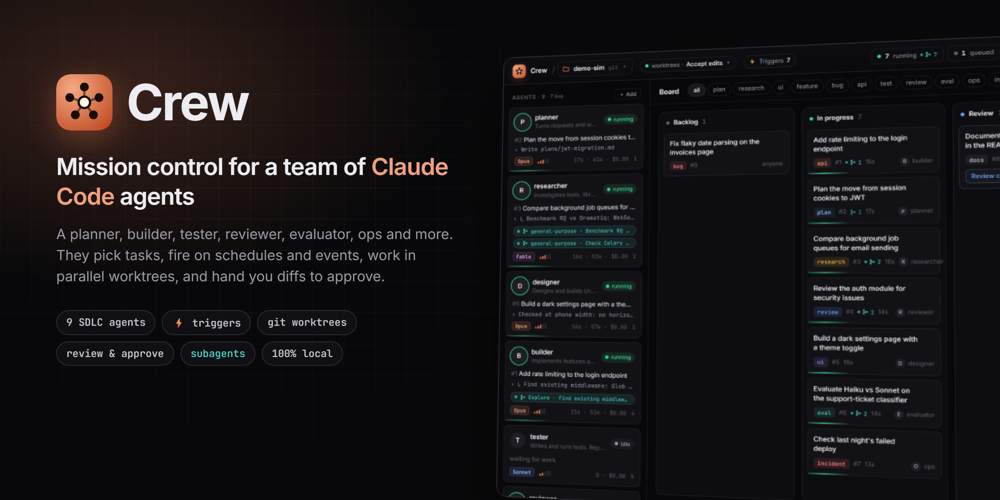
</p>

<p align="center">
  <a href="LICENSE"></a>
  
  
  
  <a href="https://github.com/pranjal-joshi/claude-crew/stargazers"></a>
</p>

<p align="center">
  <b>Run a crew of Claude Code agents, one for each stage of your SDLC.</b><br>
  They pick tasks off a board, run in workflows you chain together, start on schedules and events, and hand you diffs to approve.<br>
  One Python file, one HTML file, no dependencies.
</p>

<p align="center">
  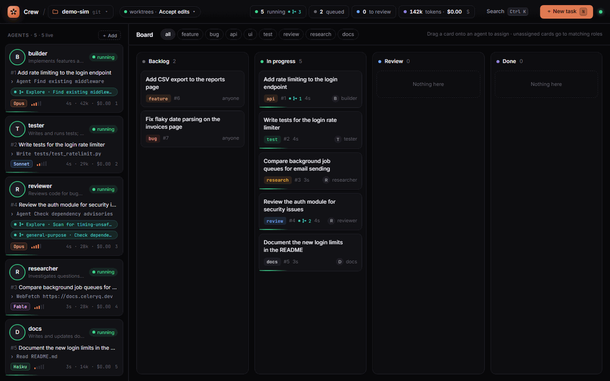
</p>

## Try it in 10 seconds

No Claude CLI, no API key, no tokens. Simulated agents play through a real board:

```bash
git clone https://github.com/pranjal-joshi/claude-crew && cd claude-crew
python server.py --demo
```

Open **http://127.0.0.1:8770**.

## Install

Crew is pure standard-library Python (3.10 or newer) and installs as a `crew` command. [pipx](https://pipx.pypa.io/) keeps it isolated:

```bash
pipx install claude-crew                      # from PyPI, once published
pipx install https://github.com/pranjal-joshi/claude-crew/releases/download/v0.1.0/claude_crew-0.1.0-py3-none-any.whl   # a release wheel
pipx install git+https://github.com/pranjal-joshi/claude-crew   # latest main
```

Then `crew --demo` or `crew --project /path/to/your/repo` behaves exactly like `python server.py ...`. When installed, the default `crew.json` lives in the folder you run `crew` from; state and worktrees stay in `~/.crew`. `crew --version` prints the version.

## Use it on your code

You need [Claude Code](https://docs.claude.com/en/docs/claude-code) installed and signed in (`claude` works in your terminal).

```bash
python server.py --project /path/to/your/repo
```

To use it from your phone or another computer on the same Wi-Fi, add `--lan`, then click **Phone** in the header and scan the QR code. On a phone it lays out like an app:

```bash
python server.py --project /path/to/your/repo --lan
```

That's it. Add tasks or set up [triggers](#triggers), and the agent whose tags match picks each task up.

## Why

Claude Code is great at one task at a time. Real work is a queue: a feature, its tests, a review, some research, the docs.
Running a terminal per task means many places to watch, changes tangled in one checkout, no single place to say yes or no, and nothing that starts work while you're away.

Crew gives that queue a home:

- **One board** for every task, with Backlog, In progress, Review and Done columns.
- **Agents that pull their own work.** Each agent has a role and tags; idle agents take matching tasks.
- **No stepping on each other.** Every agent works in its own git worktree on its own `crew/<name>` branch.
- **You stay the reviewer.** Finished work lands in Review with the agent's summary and a real diff. Approve commits it; Send back resumes the same session with your feedback.
- **Work that starts itself.** Schedules, events, file watches, command polls and webhooks turn into tasks, so the standup gets written at 11:00 and every approved feature gets tests.

## The boss

A chat bar at the bottom (<kbd>/</kbd>) talks to the **boss**: a Claude session that runs the crew instead of writing code. Ask it to "plan and build CSV export, then have it tested and reviewed" and it creates tasks, assigns agents, starts workflows, messages or stops agents, and adds triggers, through a small set of crew tools (`crew_mcp.py`). Switch the chat to any agent to talk to it directly.

Type <kbd>/</kbd> in the chat bar (or in an agent's message box) for a picker of commands and skills: Crew's own `/clear` `/compact` `/stop`, plus that agent's Claude Code slash commands and skills with their descriptions. <kbd>↑</kbd><kbd>↓</kbd> to move, <kbd>Tab</kbd> or <kbd>Enter</kbd> to pick, <kbd>Esc</kbd> to close.

The boss runs with only the crew tools and a few read-only ones, so a turn costs about 10k tokens of context instead of your full setup.

**Auto Workflow Builder** (Workflows tab): describe a process in plain words, and the boss maps it onto agents, workflows and triggers. It reuses agents that fit, adds the missing ones, and creates triggers for any schedule or event you mention.

**Auto hand-off**: every agent has a `handoff` tool. When its finished work clearly needs another specialist, it hands a follow-up to a teammate by name, or `auto` by tag. Chains stop after five hops. The manual hand-off menu is unchanged, and it now also offers **Auto**: the boss picks the agent.

## The crew

Nine agents, one per stage of the delivery loop. Each owns a few tags, so an unassigned task goes to the right specialist. Change any of it from the UI.

| Stage | Agent | Picks up | Default model | What it does |
| --- | --- | --- | --- | --- |
| Plan | **planner** | `plan` `triage` | Opus · high | Turns requests and work items into small, testable tasks with acceptance criteria. Plans, never implements. |
| Research | **researcher** | `research` `spike` | Fable · high | Compares tools and approaches with evidence and cost, ends with one recommendation. |
| Design | **designer** | `ui` `design` | Opus · high | Prototypes and builds UI: components, dark themes, accessibility, phone widths. |
| Build | **builder** | `feature` `bug` `api` `refactor` | Opus · high | Smallest change that meets the criteria, with tests for new behaviour. |
| Test | **tester** | `test` `qa` | Sonnet · medium | Reproduces bugs with failing tests first; reports exact commands and output. |
| Review | **reviewer** | `review` `security` | Opus · xhigh | Correctness, security and domain review; fixes only clear defects, ranks the rest. |
| Evaluate | **evaluator** | `eval` `data` `ml` | Opus · high | Model and prompt evals, A/B and shadow checks, with sample sizes, not anecdotes. |
| Ship & observe | **ops** | `ops` `deploy` `incident` `chore` | Sonnet · high | CI/CD, deployments, telemetry, cost, incidents and repo hygiene. Diagnoses before it changes anything. |
| Report | **scribe** | `docs` `report` | Sonnet · low | Standups, PR descriptions, release notes and docs. Short and linked. |

## Workflows

The **Workflows** tab (<kbd>W</kbd>) chains agents in a fixed order. Run one with a goal, and step 1's task is created. When a step is done, the next step's task is created with the earlier steps' summaries and an instruction to merge the previous agent's branch, so each agent builds on real work.

Each link has a gate: ✋ waits for you to approve the step, ⚡ continues on its own when the agent finishes.

| Workflow | Steps |
| --- | --- |
| Feature delivery | planner ✋ → builder ✋ → tester ⚡ → reviewer ✋ → scribe |
| Bug fix | tester (failing test) ⚡ → builder ✋ → reviewer |
| Spike to plan | researcher ✋ → planner |
| Model change | evaluator (baseline) ⚡ → builder ✋ → evaluator (re-eval) |
| Incident | ops (diagnose) ✋ → builder ✋ → tester ⚡ → scribe (post-mortem) |

Edit workflows on a **canvas**, n8n-style: a **When** block (▶ Run by hand, or any trigger), one block per agent step, and an **Output** block. Drag blocks to reorder, drag an agent from the left onto the canvas (or press ＋ on a line) to add a step, and click ✋ / ⚡ on a line to switch its gate. Click a block to edit its instruction (`{input}`, `{prev_summary}`, `{prev_branch}` and more). Runs show live progress per step, and click through to each step's task.

The **Output** block decides what a finished run delivers:

| Output | What happens |
|---|---|
| 📋 Board (default) | Nothing extra; the last step's card holds the result. |
| 📄 Report file | A markdown report of every step (who, branch, commit, summary) is saved in the project, `crew-reports/` by default. |
| 🔗 Webhook | The run report is POSTed as JSON (`workflow, run, title, status, report, steps`) to a URL, e.g. a Slack or Teams hook. |
| ⛓ Next workflow | Another workflow starts with the same goal and this run's last summary (at most 5 in a chain). |

## Stop, kill, clear

- **■ Stop** (agent card, drawer, or **Stop all** in the header) ends the current run at once. The session is kept, the task goes back to the backlog **on hold**, and the agent pauses until you press **▶ Resume** or give it work.
- **Kill** disables an agent until you respawn it. Use it for an agent that misbehaves.
- **Clear ▾** removes Done tasks, or the whole board (running agents are stopped first). Branches and commits are kept.
- **Clear** (red button, top right of an open boss or agent chat) wipes that conversation and empties its context: the next message starts a fresh session.

Every agent and every card has a **⋮** menu at its top right: rename, settings, stop, kill or delete an agent; forward (hand off), move or delete a card. Hand-offs show a forward arrow with who it went to. Click a card on the board to open the agent that handled it. Drag agents in the left rail to reorder the crew; the order is saved to `crew.json`. Collapse the rail with « to a slim column of avatars and status dots, and » brings it back (remembered per browser).

## Context per task

Each agent starts a **fresh Claude session for every new task** by default. Old tasks aren't re-read on every turn, so tokens stay low and context doesn't fill up. What should carry over already travels with the task: the hand-off summary, the previous step's branch, the workflow brief. Send back still resumes the same session, so the agent revises its own work. Switch any agent to **Keep across tasks** in ⚙ Model & role. Each agent's drawer shows how full its context is, with **Compact** (Claude Code's `/compact`) and **New session**.

## Triggers

Assigning a task is the manual trigger. Press <kbd>T</kbd> for the automatic ones. Each firing adds a task from a template, and the dispatcher hands it out like any other.

| Trigger | Fires when | Example |
| --- | --- | --- |
| ◷ **Schedule** | A cron expression matches, in local time | `0 11 * * 1-5`: the scribe writes the standup report |
| ↯ **Event** | A task reaches Review, is approved, or fails (filter by tag or agent) | An approved `feature` becomes "Write tests for #{id}" for the tester |
| ◉ **File watch** | Files matching a glob change in the project | `**/*prompt*` changes, so the evaluator reruns the evals |
| ⟳ **Poll command** | A command's output changes, it starts failing, or it prints something new | `gh run list --status failure --limit 1` every 10 min goes to ops |
| ⇢ **Webhook** | Something POSTs to the trigger's URL with its secret token | CI posts after a deploy, so ops checks telemetry |

Task templates take placeholders: `{date}` `{time}` everywhere, plus `{id}` `{title}` `{who}` `{summary}` `{branch}` `{commit}` `{merge}` for events, `{files}` for watches, `{output}` `{exit}` for polls and `{payload}` for webhooks. Event chains stop after five hops, and a trigger never fires on its own tasks.

```bash
curl -X POST "http://127.0.0.1:8770/api/hook/t7" -H "X-Crew-Token: <token from the UI>" -d "deployed api v2.4 to preprod"
```

Nine presets cover the common loops: daily standup, test what ships, review what merges, plan then build, CI failure watch, nightly hygiene, deploy webhook, prompt changes trigger re-evals, and proofreading changed docs.

## Features

| | |
| --- | --- |
| 🧑‍🤝‍🧑 **An SDLC crew** | Planner, researcher, designer, builder, tester, reviewer, evaluator, ops and scribe by default. Add, remove and re-role agents from the UI. |
| ⛓ **Workflows** | Chain agents in order (plan → build → test → review → write-up) on an n8n-style canvas, with an approval or auto gate per step and a choice of output: board, report file, webhook or next workflow. |
| ⚡ **Triggers** | Schedules, task events, file watches, command polls and webhooks start work on their own. Presets included. |
| 🧹 **Fresh context per task** | A new session per task keeps tokens down; send-back still resumes. Per-agent switch. |
| 🧠 **Model and effort per agent** | Opus for the builder, Sonnet for the tester, Fable for research: each agent gets its own model and effort level (low to max). |
| 🪢 **Subagents, visible** | When an agent fans out to subagents, you see each one live on the agent card, a count on the task, and a labelled thread in the transcript. |
| 🌳 **Worktree isolation** | One worktree and branch per agent. Merge what you approve with `git merge crew/<name>`. |
| 🔍 **Review gate** | Agent summary and colored diff side by side. Approve and commit, send back, or hand off to another agent. |
| ↪️ **Hand-offs** | Drag any card, in any column, onto another agent. The earlier summary, branch and commit go along as context. |
| ✦ **Boss chat** | A chat bar that runs the crew: tasks, workflows, agents and triggers, from plain requests. |
| ⌨ **Slash picker** | Type `/` in any chat box for Crew commands plus the agent's Claude Code commands and skills. **Clear** in the chat panel wipes a chat and its context. |
| 💬 **Talk mid-run** | Message any agent while it works. The message lands in the running session. |
| 📱 **Phone app feel** | `--lan` plus a QR code. On a phone: bottom navigation, swipeable columns, bottom sheets, Android back closes sheets. |
| ■ **Stop, kill, clear** | Stop a run (session kept, task on hold), stop everything at once, or clear the board. |
| 🔐 **Permission modes** | Accept edits (default), Auto (Claude Code's safety classifier) or Bypass, for all agents from one switch. |
| 🔢 **Tokens and cost** | Live token counts per agent, per task and in total. Hide the dollar amounts with one click. |
| 🧩 **Your skills and MCP servers** | Agents are ordinary Claude Code sessions, so they load your skills, plugins and MCP servers. |
| 📁 **Projects** | Switch repos from the header. Each project keeps its own board, sessions and worktrees. |
| ⌨️ **Keyboard first** | `/` talk to the boss, `N` new task, `T` triggers, `W` / `B` workflows / board, `1`–`9` open an agent, `Ctrl K` command palette, `Esc` close. |

## Screenshots

<table>
  <tr>
    <td width="50%">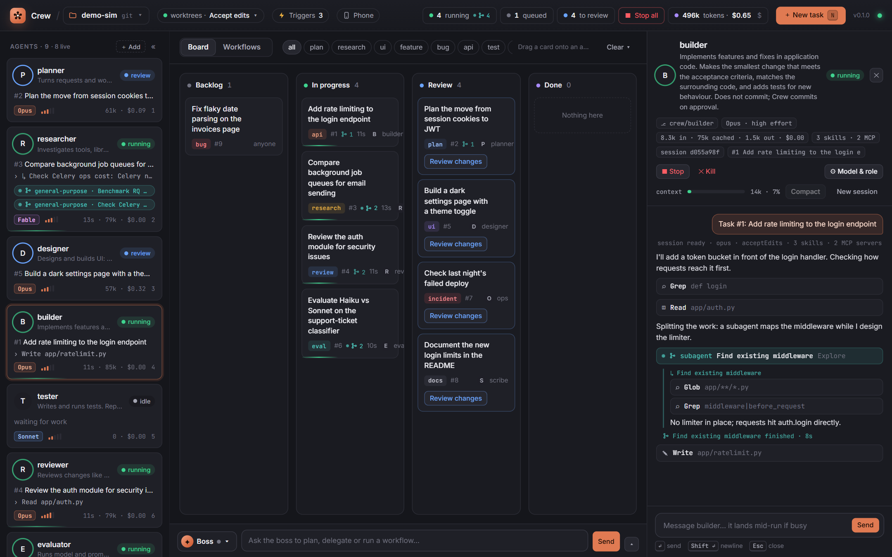<br><sub><b>Agent view.</b> Live transcript; subagents get their own labelled thread.</sub></td>
    <td width="50%">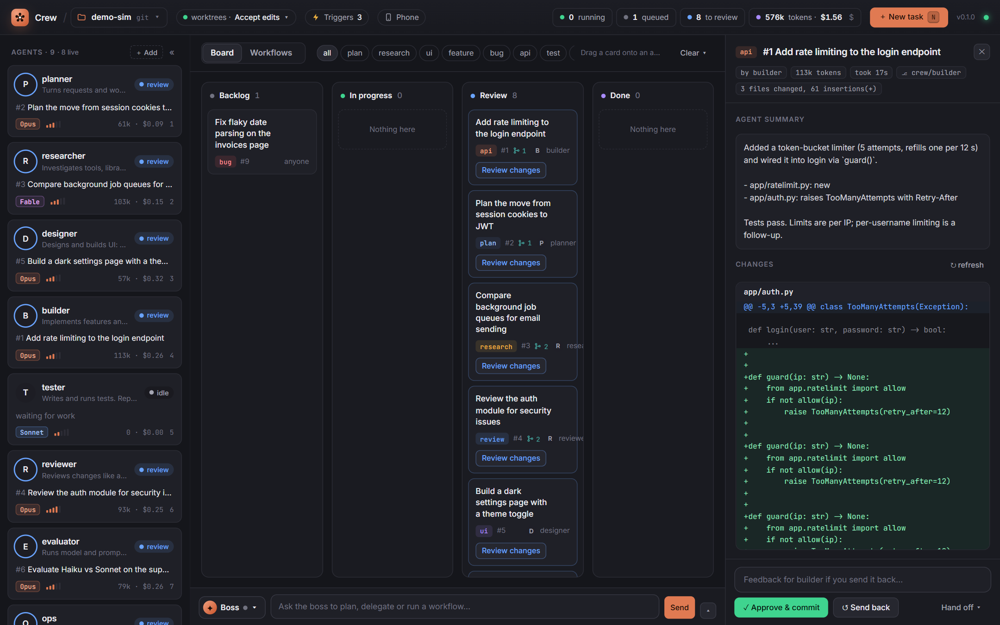<br><sub><b>Review.</b> The agent's summary and its diff. Approve commits to its branch.</sub></td>
  </tr>
  <tr>
    <td width="50%">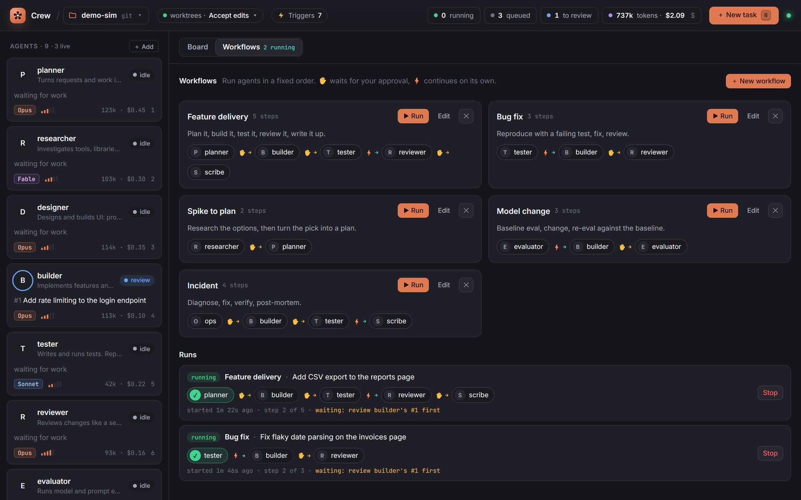<br><sub><b>Workflows.</b> Agents in a fixed order; runs show each step live. Run has a green ▶.</sub></td>
    <td width="50%">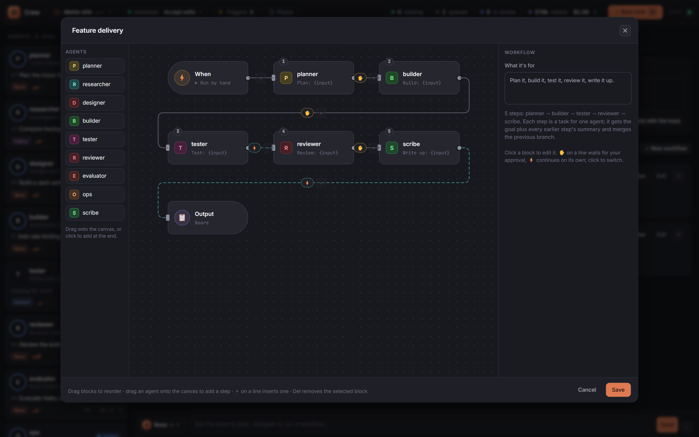<br><sub><b>Workflow editor.</b> When → agents → Output on a canvas; drag to reorder, ✋ / ⚡ on each line.</sub></td>
  </tr>
  <tr>
    <td width="50%">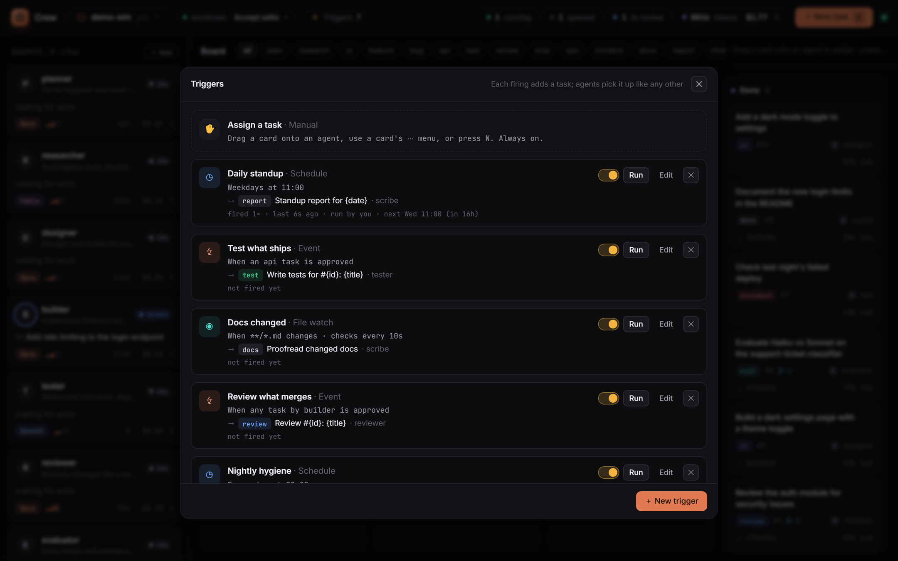<br><sub><b>Triggers.</b> Schedules, events, watches, polls and webhooks, each with its next run and history.</sub></td>
    <td width="50%">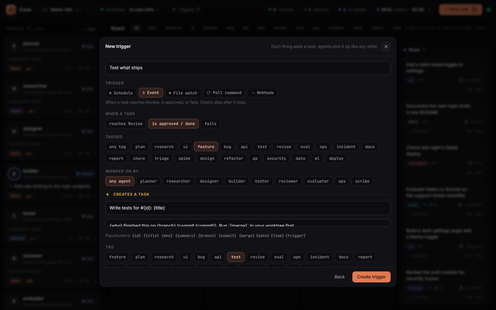<br><sub><b>Trigger editor.</b> Pick when it fires and the task it creates, with placeholders.</sub></td>
  </tr>
  <tr>
    <td width="50%">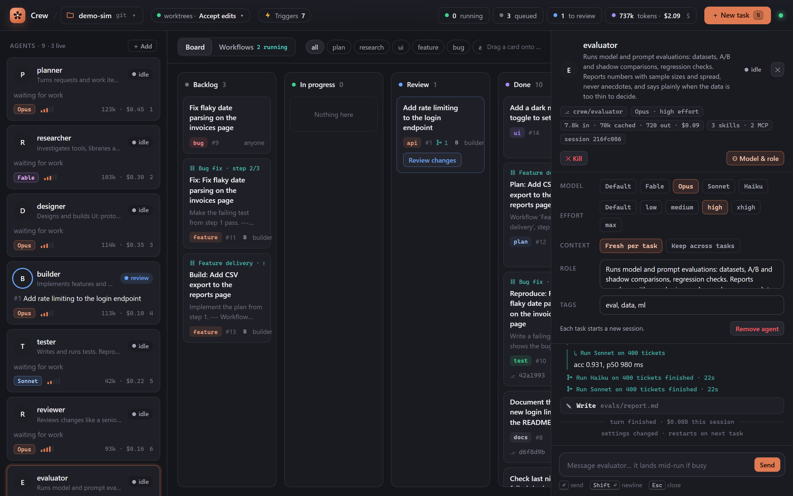<br><sub><b>Model and role.</b> Per-agent model, effort, role and tags.</sub></td>
    <td width="50%">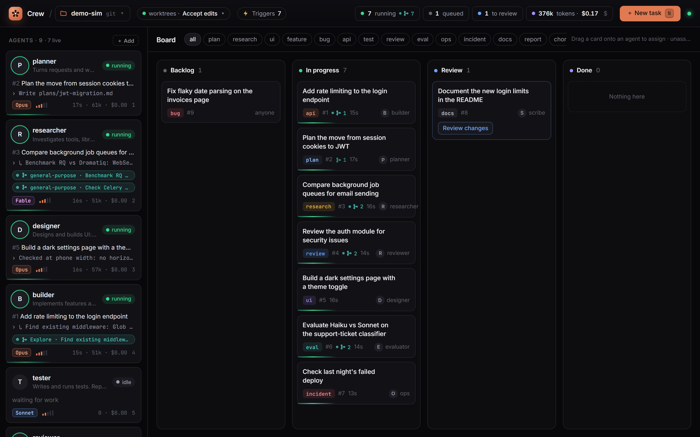<br><sub><b>Board.</b> Agents in flight, subagents counted on each card.</sub></td>
  </tr>
  <tr>
    <td width="50%">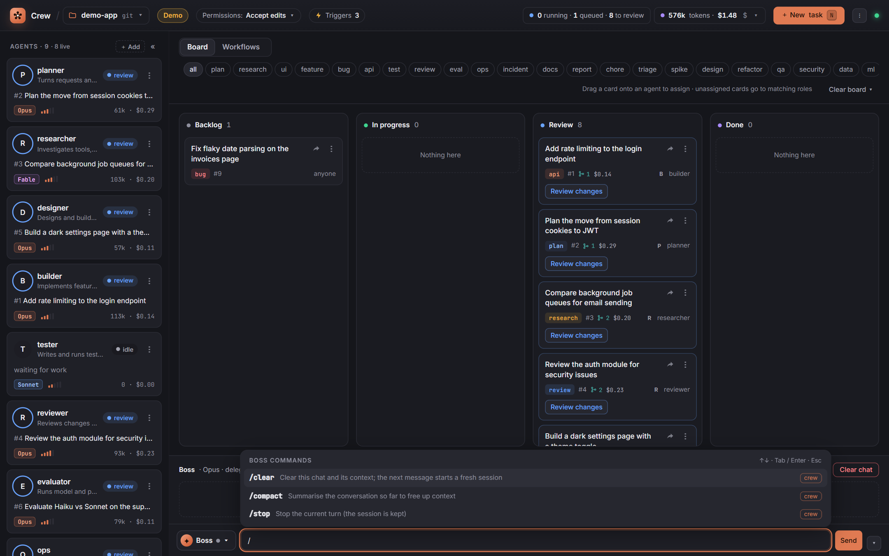<br><sub><b>Slash picker.</b> Type <code>/</code> for Crew commands, plus an agent's commands and skills.</sub></td>
    <td width="50%">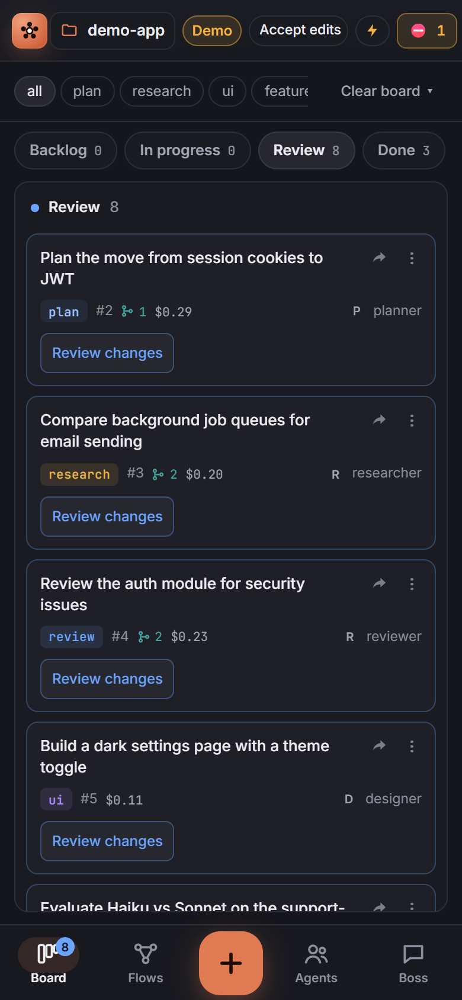 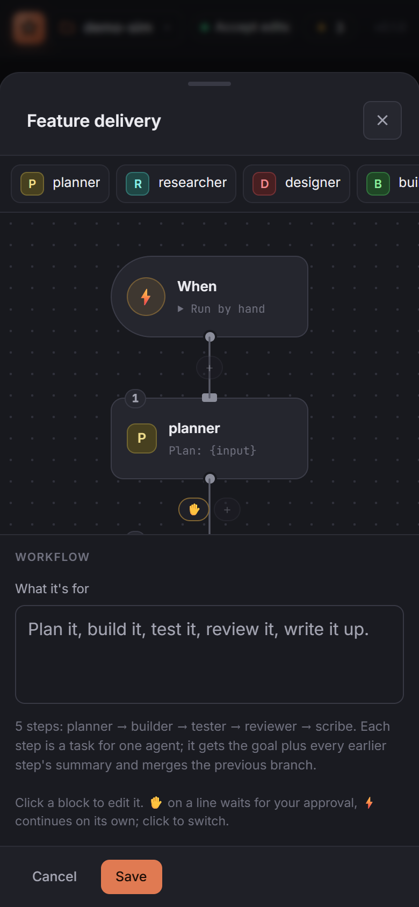<br><sub><b>On a phone.</b> Bottom navigation, swipeable columns, and a vertical canvas.</sub></td>
  </tr>
</table>

## How it works

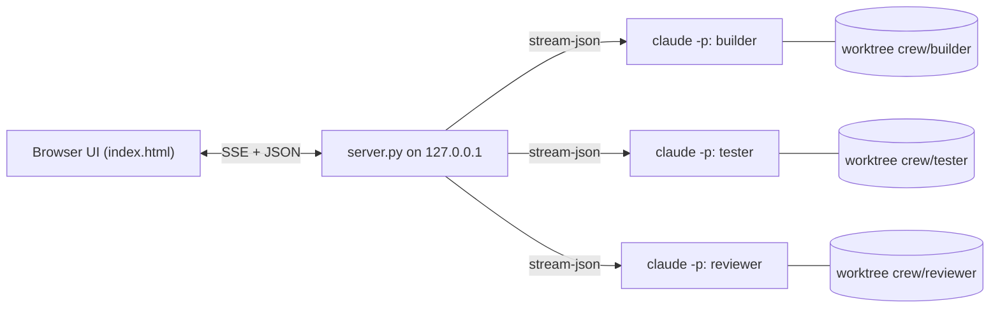

- Each agent is a long-lived `claude -p --input-format stream-json --output-format stream-json` process. Crew writes tasks and your messages to its stdin and reads every event from its stdout.
- A one-second loop checks triggers, then gives idle agents work: tasks pinned to them first, then unassigned tasks whose tag matches the agent's tags.
- Subagents are tracked from the stream itself. An `Agent` tool call starts one, events tagged with its `parent_tool_use_id` belong to it, and its tool result ends it.
- State (board, triggers, sessions, tokens, transcripts) is saved per project under `~/.crew/state/`. Worktrees live in `~/.crew/wt/`, which keeps paths short enough for Windows.

## Configuration

`crew.json` is created next to `server.py` on first run (in the current folder when installed with pipx) and saved whenever you change things in the UI.

```jsonc
{
  "permission_mode": "acceptEdits",          // or "auto", "bypassPermissions"
  "allowed_tools": ["Bash(git status:*)", "Bash(npm test:*)", "Bash(pytest:*)", "WebSearch"],
  "allow_mcp": true,                         // auto-allow MCP servers agents discover (Accept edits mode)
  "agents": [
    {"name": "builder", "role": "Implements features and fixes.", "tags": ["feature", "bug", "api", "refactor"],
     "model": "opus", "effort": "high"}
  ]
}
```

| Flag | Default | |
| --- | --- | --- |
| `--project PATH` | a demo repo in `~/.crew` | The repo agents work on. |
| `--port N` | `8770` | |
| `--config PATH` | `crew.json` | Next to `server.py` from a clone, in the current folder when installed. |
| `--version` | | Print the version and exit. |
| `--demo` | off | Simulated agents and sample tasks. |

`CREW_CLAUDE` overrides the command used to start agents.

### Permissions

Headless agents can't answer permission prompts. In **Accept edits** mode, file edits are allowed and Bash commands outside `allowed_tools` are refused, and the agent is told why. Add the commands your project needs to `allowed_tools`, or switch to **Auto** to let Claude Code's classifier decide. **Bypass** skips all checks and asks you to confirm first.

## Security

- The server binds to `127.0.0.1` only.
- Every write needs a custom request header and a localhost `Host`, so other websites can't drive your agents (CSRF and DNS rebinding).
- `--lan` listens on your network, but every request from another device needs a secret key (set as a cookie by the QR link) and a bare-IP `Host`. The key lives in `~/.crew/lan-key`; delete it to sign every device out. Traffic is plain HTTP, so use it on networks you trust.
- Agents are told to stay inside the project folder unless a task names another path.
- Webhooks are the one write path without the browser header. Each needs its own random token, compared in constant time.
- Poll triggers run the command you typed, in your shell, in the project folder. Treat them like a cron job you wrote yourself.

## FAQ

**Does it cost extra?** No. Agents use your own Claude Code login, so usage counts against your plan or API key like any other Claude Code session. The token counter shows what each agent used.

**Can agents use my skills and MCP servers?** Yes. Each agent loads what `claude` loads in your terminal: user skills, plugins, user MCP servers and claude.ai connectors. Crew also brings along what git leaves out of a worktree: local-scope MCP servers (`claude mcp add` without `--scope user`), an uncommitted `.mcp.json`, `.claude/settings.local.json`, untracked project skills, agents and commands, and `CLAUDE.local.md`. Click the skills · MCP chip in an agent's drawer to see exactly what it loaded. Connectors that need sign-in must be signed in once with `claude` → `/mcp`.

**Can an agent spawn its own subagents or background jobs?** Yes, they're full Claude Code sessions. Crew shows subagents live. Kill ends the whole process tree, background jobs included.

**How do I merge an agent's work?** Approve commits to the agent's branch. Then `git merge crew/builder` (or open a PR) like any other branch.

**Which platforms?** Built and tested on Windows 11. macOS and Linux use the same code paths (process groups instead of `taskkill`); reports welcome.

## Roadmap

- [ ] Shared crew memory: a notes file every agent reads at start and adds to at the end
- [ ] Hand-offs that merge the previous agent's branch into the next agent's worktree
- [x] Live subagent indicators
- [ ] Background-job and monitor indicators, and holding a task until its jobs finish
- [x] Event triggers chain work ("tests after feature")
- [x] Workflows: agents in a fixed order with approval gates
- [ ] Parallel steps in workflows (fan out, then join)
- [ ] One-click merge of approved branches

Ideas and PRs welcome. Open an issue first for anything big.

## Contributing

The whole app is two files: `server.py` (Python standard library) and `index.html` (vanilla JS). `python server.py --demo` is the fastest loop; `demo/fake_claude.py` speaks the same stream-json protocol as Claude Code.

Tests are standard-library `unittest` (`python -m unittest discover`), lint is `ruff check .`, and CI runs both on Linux, Windows and macOS.

## Releasing

1. Bump `__version__` in `server.py` (the single source of the version) and add an entry to `CHANGELOG.md`.
2. Commit, then tag and push: `git tag vX.Y.Z && git push origin vX.Y.Z`.
3. The **Release** workflow runs the tests, checks the tag matches `__version__`, builds the sdist and wheel, and creates a GitHub Release with both attached and generated notes.

To also publish to PyPI: create a [trusted publisher](https://docs.pypi.org/trusted-publishers/) for the project `claude-crew` (owner `pranjal-joshi`, repo `claude-crew`, workflow `release.yml`, environment `pypi`), then set the repository variable `PUBLISH_PYPI` to `true`. Until then the PyPI job is skipped and releases still succeed.

## Star history

<a href="https://www.star-history.com/#pranjal-joshi/claude-crew&type=date&legend=top-left">
 <picture>
   <source media="(prefers-color-scheme: dark)" srcset="https://api.star-history.com/svg?repos=pranjal-joshi/claude-crew&type=date&theme=dark&legend=top-left" />
   <source media="(prefers-color-scheme: light)" srcset="https://api.star-history.com/svg?repos=pranjal-joshi/claude-crew&type=date&legend=top-left" />
   
 </picture>
</a>

---

<p align="center">
  If Crew saves you a few terminals, a ⭐ helps others find it.<br>
  <sub>Crew is an independent project and is not affiliated with or endorsed by Anthropic. Claude and Claude Code are trademarks of Anthropic.</sub>
</p>
