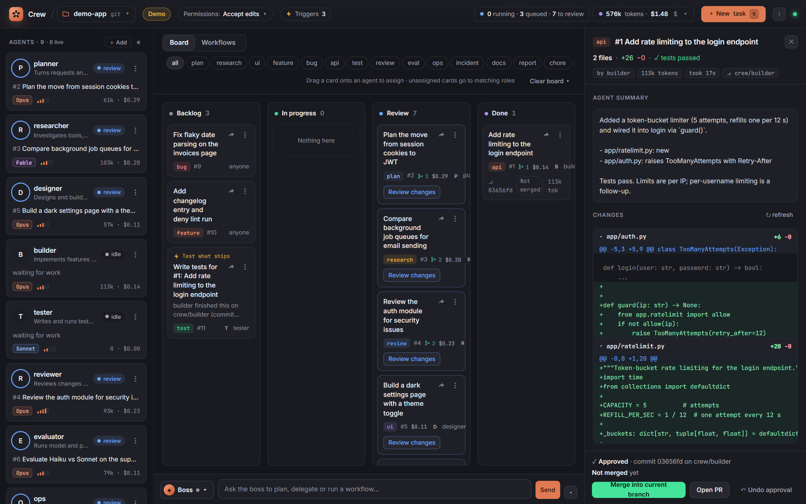
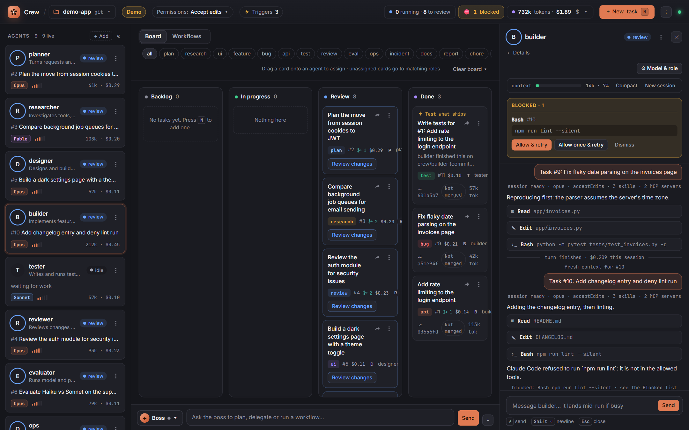
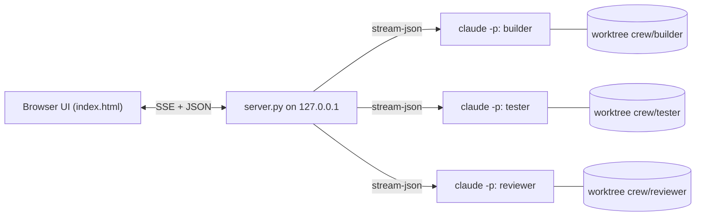

<p align="center">
  
</p>

<p align="center">
  <a href="LICENSE"></a>
  
  
  
  <a href="https://github.com/pranjal-joshi/claude-crew/stargazers"></a>
</p>

<p align="center">
  <b>Run a crew of Claude Code agents, one for each stage of your SDLC.</b><br>
  They pick tasks off a board, run in workflows you chain together, start on schedules and events, and hand you diffs to approve.<br>
  One Python file, one HTML file, no dependencies.
</p>

<p align="center">
  
</p>

## Try it in 10 seconds

No Claude CLI, no API key, no tokens. Simulated agents play through a real board:

```bash
git clone https://github.com/pranjal-joshi/claude-crew && cd claude-crew
python server.py --demo
```

Open **http://127.0.0.1:8770**. On an empty board a first-run card offers one example task; a **Demo** badge in the header tells demo from a real project.

## Install

Crew is pure standard-library Python (3.10 or newer) and installs as a `crew` command. [pipx](https://pipx.pypa.io/) keeps it isolated:

```bash
pipx install claude-crew                      # from PyPI, once published
pipx install https://github.com/pranjal-joshi/claude-crew/releases/download/v0.6.0/claude_crew-0.6.0-py3-none-any.whl   # a release wheel
pipx install git+https://github.com/pranjal-joshi/claude-crew   # latest main
```

Then `crew --demo` or `crew --project /path/to/your/repo` behaves exactly like `python server.py ...`. When installed, the default `crew.json` lives in the folder you run `crew` from; state and worktrees stay in `~/.crew`. `crew --version` prints the version.

## Use it on your code

You need [Claude Code](https://docs.claude.com/en/docs/claude-code) installed and signed in (`claude` works in your terminal).

```bash
python server.py --project /path/to/your/repo
```

To use it from your phone or another computer on the same Wi-Fi, add `--lan`, then open the header **⋮** menu, choose **Phone**, and scan the QR code. On a phone it lays out like an app:

```bash
python server.py --project /path/to/your/repo --lan
```

That's it. Add tasks or set up [triggers](#triggers), and the agent whose tags match picks each task up.

## Why

Claude Code is great at one task at a time. Real work is a queue: a feature, its tests, a review, some research, the docs.
Running a terminal per task means many places to watch, changes tangled in one checkout, no single place to say yes or no, and nothing that starts work while you're away.

Crew gives that queue a home:

- **One board** for every task, with Backlog, In progress, Review and Done columns.
- **Agents that pull their own work.** Each agent has a role and tags; idle agents take matching tasks.
- **No stepping on each other.** Every agent works in its own git worktree on its own `crew/<name>` branch.
- **You stay the reviewer.** Finished work lands in Review as a decision sheet: the agent's summary, a verdict line (files, +/-, tests) and a per-file diff. Approve commits it, then one click merges the branch or opens a PR. Send back resumes the same session with your feedback.
- **Work that starts itself.** Schedules, events, file watches, command polls and webhooks turn into tasks, so the standup gets written at 11:00 and every approved feature gets tests.

## The boss

A chat bar at the bottom (<kbd>/</kbd>) talks to the **boss**: a Claude session that runs the crew instead of writing code. Ask it to "plan and build CSV export, then have it tested and reviewed" and it creates tasks, assigns agents, starts workflows, messages or stops agents, adds triggers and card buttons, through a small set of crew tools (`crew_mcp.py`). Switch the chat to any agent to talk to it directly.

Type <kbd>/</kbd> in the chat bar (or in an agent's message box) for a picker of commands and skills: Crew's own `/clear` `/compact` `/stop`, plus that agent's Claude Code slash commands and skills with their descriptions. <kbd>↑</kbd><kbd>↓</kbd> to move, <kbd>Tab</kbd> or <kbd>Enter</kbd> to pick, <kbd>Esc</kbd> to close.

The boss runs with only the crew tools and a few read-only ones, so a turn costs about 10k tokens of context instead of your full setup.

**Let the boss set it up**: describe a process in plain words in the boss chat ("every weekday at 10, triage new ADO bugs, fix, review"), and it maps it onto agents, workflows and triggers. It reuses agents that fit, adds the missing ones, and creates triggers for any schedule or event you mention.

**Auto hand-off**: every agent has a `handoff` tool. When its finished work clearly needs another specialist, it hands a follow-up to a teammate by name, or `auto` by tag. Chains stop after five hops. The manual hand-off menu is unchanged, and it now also offers **Auto**: the boss picks the agent.

## The crew

Nine agents, one per stage of the delivery loop. Each owns a few tags, so an unassigned task goes to the right specialist. Change any of it from the UI.

| Stage | Agent | Picks up | Default model | What it does |
| --- | --- | --- | --- | --- |
| Plan | **planner** | `plan` `triage` | Opus · high | Turns requests and work items into small, testable tasks with acceptance criteria. Plans, never implements. |
| Research | **researcher** | `research` `spike` | Fable · high | Compares tools and approaches with evidence and cost, ends with one recommendation. |
| Design | **designer** | `ui` `design` | Opus · high | Prototypes and builds UI: components, dark themes, accessibility, phone widths. |
| Build | **builder** | `feature` `bug` `api` `refactor` | Opus · high | Smallest change that meets the criteria, with tests for new behaviour. |
| Test | **tester** | `test` `qa` | Sonnet · medium | Reproduces bugs with failing tests first; reports exact commands and output. |
| Review | **reviewer** | `review` `security` | Opus · xhigh | Correctness, security and domain review; fixes only clear defects, ranks the rest. |
| Evaluate | **evaluator** | `eval` `data` `ml` | Opus · high | Model and prompt evals, A/B and shadow checks, with sample sizes, not anecdotes. |
| Ship & observe | **ops** | `ops` `deploy` `incident` `chore` | Sonnet · high | CI/CD, deployments, telemetry, cost, incidents and repo hygiene. Diagnoses before it changes anything. |
| File | **ticketer** | `intake` `ticket` | Sonnet · medium | Turns a request from anywhere (a Teams message, an alert, a failed pipeline) into a Bug or PBI, or links an open duplicate, and shares the link back where it came from. |
| Report | **scribe** | `docs` `report` | Sonnet · low | Standups, PR descriptions, release notes and docs. Short and linked. |

## Workflows

The **Workflows** tab (<kbd>W</kbd>) chains agents in a fixed order. Run one with a goal, and step 1's task is created. When a step is done, the next step's task is created with the earlier steps' summaries and an instruction to merge the previous agent's branch, so each agent builds on real work.

**Fix a broken pipeline.** When a deploy watch (a ⟳ step whose agent is tagged `deploy` or `cd`) sees its pipeline run fail, its card shows **🛠 Fix pipeline**, and the agent can ask for the same with the crew tool `fix_pipeline`. That starts the *Pipeline fix* workflow, made from your crew's tags the first time (a fixer tagged `bug`, a shipper tagged `release` or `chore`, a CI agent tagged `ci` or `review`; edit it in Workflows like any other): the fixer finds the cause in the run's log, the shipper opens a PR linked to the same work item, and the CI agent keeps it green until it merges. Each step first looks for a fix someone else already shipped (open and merged PRs, branches, master) and reuses it or stops. The deploy watch waits meanwhile without checking, then wakes to follow the first run that carries the fix. A second watch blocked by the same failure can join the running fix instead of starting another. A PR's CI watch does the same when its check fails on master too (not the PR's doing): it calls `fix_pipeline` instead of waiting on a master its watch can't see, and once the fix merges it brings master into its branch and carries on.

**Restart a run.** ↻ on a workflow's frame on the board restarts the whole run (with the workflow's steps as they are now) or restarts from any step whose earlier steps finished; those keep their results and the restarted step reads them. The open step stops, and every restarted step is a new task, so each agent starts on a fresh session. Earlier cards stay in Done. It works on running, stopped and finished runs.

**Gates: stop or go on.** An agent can decide whether work should go ahead with the crew tool `decide` (continue or stop, with a one-line reason). *Continue* closes its task without review and starts the next workflow step with its summary, unless that step's link is ✋: then it waits for your approval as usual, with the agent's verdict on the review card; *stop* closes it marked ⏹ stopped and ends the run, so nothing else starts. Put a gate agent such as **Picker** first in a workflow that an ADO trigger runs: it checks each new item against the ownership in its role and passes on only what is ours. Outside a workflow, a gate that continues hands the work on with `handoff` first.

Each link has a gate: ✋ waits for you to approve the step, ⚡ continues on its own when the agent finishes, and ⟳ **checks until done**: for a goal that takes hours or days, such as a PR merging or a deployment landing. A ⟳ step's agent does what it can, then Crew asks it to check again every so often (30 minutes by default) in the same session, with a short "check again" message instead of the whole brief. The step passes when the agent calls `decide` with continue, ends the run on stop, and goes to Review for you after the set number of checks. A waiting card shows ⟳ with its next check.

To keep a long wait cheap, the agent sets a **watch** (crew tool `watch`): one read-only `gh`, `az` or `git` command, such as `gh pr view 123 --json state --jq .state`, plus an optional `done` regex. Crew runs it on the step's schedule without the model and wakes the agent only when the output changes or matches `done`, so a PR that takes two days costs a few turns instead of one every half hour. Only read-only subcommands are allowed, with no shell: no pipes, redirects or `gh api` writes. The card shows 👁 while it watches.

| Workflow | Steps |
| --- | --- |
| Feature delivery | planner ✋ → builder ✋ → tester ⚡ → reviewer ✋ → scribe |
| Bug fix | tester (failing test) ⚡ → builder ✋ → reviewer |
| Spike to plan | researcher ✋ → planner |
| Model change | evaluator (baseline) ⚡ → builder ✋ → evaluator (re-eval) |
| Incident | ops (diagnose) ✋ → builder ✋ → tester ⚡ → scribe (post-mortem) |
| Request to ticket | ticketer (file it, share the link) ⚡ → planner |

Edit workflows on a **canvas**, n8n-style: a **When** block (▶ Run by hand, or any trigger), one block per agent step, and an **Output** block. Drag blocks to reorder, drag an agent from the left onto the canvas (or press ＋ on a line) to add a step, and click ✋ / ⚡ on a line to switch its gate. Steps can also **run in parallel**: ＋ on a line offers *At the same time as …*, or set *When it starts: ∥ With step N* on a step. Parallel steps stack in one column, start together, and the next step waits until all of them are done, gets all their summaries and merges all their branches. For example, triage and telemetry together, then a planner. Click a block to edit its instruction (`{input}`, `{prev_summary}`, `{prev_branch}` and more). Runs show live progress per step, and click through to each step's task.

The **Output** block decides what a finished run delivers:

| Output | What happens |
|---|---|
| 📋 Board (default) | Nothing extra; the last step's card holds the result. |
| 📄 Report file | A markdown report of every step (who, branch, commit, summary) is saved in the project, `crew-reports/` by default. |
| 🔗 Webhook | The run report is POSTed as JSON (`workflow, run, title, status, report, steps`) to a URL, e.g. a Slack or Teams hook. |
| ⛓ Next workflow | Another workflow starts with the same goal and this run's last summary (at most 5 in a chain). |

## Review, merge, budgets

A finished task lands in **Review** as a decision sheet: a verdict line, **Approve & commit** pinned at the bottom, the diff collapsed per file, and **Send back** beside it. Press <kbd>A</kbd> to approve; an undo toast lets you take it back. Once approved, **Merge into current branch** merges it in one click, or **Open PR** uses `gh` when the repo has a remote. On a conflict Crew lists the files and offers to send the task back to the agent. Done cards show merged or not merged.

**Card buttons.** Add your own one-click actions to task cards from the header **⋮** menu, **Card buttons…**, or ask the boss ("add a *Rebase* button on cards with a PR that runs /rebase in that agent"). A button shows on the cards that match it (columns, the agent or its tags, has a PR, no PR, or follows a pipeline run) and, pressed, does one of three things:

| Kind | What it does |
| --- | --- |
| Ask the card's agent | Sends a skill or an instruction to the card's agent, in the card's own session, e.g. `/rebase {pr}`. The card is In progress until the turn ends, then goes back. |
| Start a workflow | Runs a workflow with the card's title as its goal and its PR, pipeline run and summary in the brief. |
| Hand off | Gives the card to another agent (or `auto` by tag) as a new task, with a note, the PR and the summary. |

Text can use `{id}`, `{title}`, `{pr}`, `{pipeline}`, `{branch}`, `{agent}` and `{summary}`. Buttons run no shell commands themselves, which is why the boss may create them (crew tools `set_card_button` and `delete_card_button`); only you press them. They are saved in `crew.json` under `card_actions`.

Every card shows its cost. Set a **per-task** and a **per-day** budget (click the tokens/$ stat). A task that hits its budget is flagged and can't be sent back; a spent day budget stops running agents until the next local day or a higher budget.

## Stop, kill, clear

- **■ Stop** (agent card, drawer, or **Stop all** in the header) ends the current run at once. The session is kept, the task goes back to the backlog **on hold**, and the agent pauses until you press **▶ Resume** or give it work.
- **Kill** (agent ⋮ menu, behind a confirm) disables an agent until you respawn it. Use it for an agent that misbehaves.
- **Clear board ▾** removes Done tasks, or the whole board (running agents are stopped first). Branches and commits are kept.
- **Clear chat** (red button, top right of an open boss or agent chat) wipes that conversation and empties its context: the next message starts a fresh session.

Give each agent an icon (two dozen dev line icons) and a colour in its settings; the glyph switches between black and white to stay readable. Every agent and every card has a **⋮** menu at its top right: rename, settings, stop, kill or delete an agent; move, mark done or delete a card. The forward button next to a card's ⋮ hands it to an agent (or lets the boss pick), and hand-offs show the same arrow with who it went to. Click a card on the board to open the agent that handled it. Drag agents in the left rail to reorder the crew; the order is saved to `crew.json`. Collapse the rail with « to a slim column of avatars and status dots, and » brings it back (remembered per browser).

**Crew memory.** Agents save what they work out about your project with the crew tool `remember`: how a deploy is confirmed, which pipeline steps are non-blocking, who owns what. Every agent reads these facts when it starts a task. A fact has a key, so saving the same key corrects it instead of adding another. The 🧠 chip in the header lists them, and you can add, edit or forget them there.

**One card per PR or work item.** When an open card is already about a PR or a work item, news about it (the PR merged, a pipeline run carrying it finished, an alert about it) goes to that card, 📎, instead of starting new work. A waiting ⟳ card wakes up to read it.

**Alerts.** Any agent can raise an alert with the `raise_alert` crew tool when it finds something failing that you must see now: a failed deployment, a red pipeline on the main branch, an outage, expired access. Open alerts show in a strip above the board, worst first; turn one into an incident task, acknowledge it, or resolve it. Raising the same alert again bumps its count instead of adding a copy, and the agent resolves it when things recover. Crew raises its own when a trigger's check fails or the daily budget is reached.

**Continue in Claude Code.** Some work needs you at your own machine (sign-ins, MFA, a browser, prod approvals). A card's or agent's **⋮ → Continue in Claude Code** gives the exact `claude --resume` command for that agent's session in its worktree, and a hand-off brief to paste into a fresh session. A **Handoff** agent (tags `manual`, `handoff`) can write a fuller brief into `crew-handoffs/` for you.

**Export and import agents** from the header **⋮** menu: pick all or some agents and download them as a JSON file (settings only: name, role, tags, model, effort, context, icon, colour; no chats, sessions or costs), to back them up or share them. Import lists a file's agents first (an export or a `crew.json`), lets you untick some, and skips or updates agents whose names already exist.

**Workflows and triggers export the same way** (header **⋮** menu, or **Export… / Import…** on the Workflows and Triggers tabs). A workflow file holds steps, gates, output and on/off; a step that names an agent you do not have is imported but flagged, since its run would fail there. A trigger file holds the name, type, spec and task template, never a webhook token (a new one is made on import) or what the trigger fired, and **imported triggers arrive turned off**. A trigger aimed at a workflow or agent this crew lacks is skipped: import the workflows first.

## Context per task

Each agent starts a **fresh Claude session for every new task** by default. Old tasks aren't re-read on every turn, so tokens stay low and context doesn't fill up. What should carry over already travels with the task: the hand-off summary, the previous step's branch, the workflow brief. Going back to a task resumes that task's own session, even if the agent did other tasks since: replies, Send back and re-running it continue the same conversation, so the agent revises its own work. Only new tasks (from you, the boss or a trigger) start fresh. Switch any agent to **Keep across tasks** in ⚙ Model & role. Each agent's drawer shows how full its context is, with **Compact** (Claude Code's `/compact`) and **New session**.

## Triggers

Assigning a task is the manual trigger. Open the **Triggers** tab (<kbd>T</kbd>) for the automatic ones. Each firing adds a task from a template, and the dispatcher hands it out like any other.

Every trigger also shows at the top of the Backlog as a *scheduled* card with its kind and next time. Drag one to In progress to run it now; it comes back to the Backlog when the run finishes.

| Trigger | Fires when | Example |
| --- | --- | --- |
| ◷ **Schedule** | A cron expression matches, in local time | `0 11 * * 1-5`: the scribe writes the standup report |
| ↯ **Event** | A task reaches Review, is approved, or fails (filter by tag or agent) | An approved `feature` becomes "Write tests for #{id}" for the tester |
| ◉ **File watch** | Files matching a glob change in the project | `**/*prompt*` changes, so the evaluator reruns the evals |
| ⟳ **Poll command** | A command's output changes, it starts failing, or it prints something new | `gh run list --status failure --limit 1` every 10 min goes to ops |
| ⇢ **Webhook** | Something POSTs to the trigger's URL with its secret token | CI posts after a deploy, so ops checks telemetry |
| ⬡ **ADO tag** | You tag a work item on your Azure DevOps board | Tag a bug `crew`, and the Bug fix workflow starts for it |
| ⇄ **Pull request** | You open a PR outside Crew (by hand, in your IDE, another tool), or a PR of yours merges | Raised: a CI monitor keeps it green until it merges. Merged: a CD workflow deploys and checks it |
| ▶ **Pipeline** | An Azure Pipelines run finishes (only yours, if you like) | A CD release succeeds, and ADO-QA checks it and updates your work items |
| ✉ **Teams** | Someone @mentions you, or posts, in a Teams channel or chat | An @mention in *Platform > Incidents* becomes a task for Ops |

Task templates take placeholders: `{date}` `{time}` everywhere, plus `{id}` `{title}` `{who}` `{summary}` `{branch}` `{commit}` `{merge}` for events, `{files}` for watches, `{output}` `{exit}` for polls and `{payload}` for webhooks. Event chains stop after five hops, and a trigger never fires on its own tasks.

```bash
curl -X POST "http://127.0.0.1:8770/api/hook/t7" -H "X-Crew-Token: <token from the UI>" -d "deployed api v2.4 to preprod"
```

Nine presets cover the common loops: daily standup, test what ships, review what merges, plan then build, CI failure watch, nightly hygiene, deploy webhook, prompt changes trigger re-evals, and proofreading changed docs.

### Start work from your ADO board

Tag a work item, and Crew starts a workflow for it. No copy and paste.

1. **Prerequisites.** The Azure CLI, signed in (`az login`), with the DevOps extension (`az extension add --name azure-devops`). Crew uses your `az` session; it stores no token. Defaults from `az devops configure --defaults organization=... project=...` prefill the form.
2. **Set up the trigger.** Open the **Triggers** tab (<kbd>T</kbd>), **New trigger**, **ADO tag**. Pick the tag you will use (you choose it, for example `crew`), the organization and project, and a workflow (or one agent). Optionally limit it to Bug, Product Backlog Item, Task or User Story, and set how often to check (5 min by default). **Test** lists the items that match right now, read-only.
3. **Tag items.** Add your tag to a work item on the board. At the next check Crew starts one run for it, titled `AB#123 <title>`, with the item's type, state, link and description in the brief. The card shows an `AB#123` chip that opens the item.
4. **What Crew writes back.** By default it adds the tag `crew-picked` (so it is never picked twice) and posts a comment: "Picked up by Crew: Bug fix, run #3". You can instead remove your tag, or leave tags alone. If the write fails, the run still goes ahead and the item is not started again; the trigger shows the warning.

**Assigned to me.** In the same form, set *Pick up items* to **assigned to me** instead of a tag: each item newly assigned to your `az` user starts one run, once. Items already assigned when the trigger starts are skipped (remembered on its first check) unless you choose *start them too*. Tags are left alone; the optional comment is still posted.

**Pipeline trigger.** **New trigger**, **Pipeline**: add the pipelines by name (the list offers your project's names), choose *succeeds*, *partially succeeds*, *fails* or *finishes*, and an agent or workflow to start. Each finished run starts work once, titled `pipeline result`, with the run link, branch, commit, who it ran for and the run's linked work items. **Only runs for me** keeps runs requested for you or carrying a work item assigned to you (a release build runs as whoever merged, so its linked items tell whose work shipped); your items are listed first and the card links the first one, so an agent like ADO-QA can update or close them. Uses your `az` sign-in, read-only. **Test** lists matching runs from the last 7 days.

**Pull request trigger.** **New trigger**, **Pull request** (or the *Monitor PRs I open* preset): choose GitHub (through `gh`) or Azure Repos (through `az`), optionally a repository (empty means this project's origin, or every repo in the ADO project), and a workflow or agent to start, such as *PR CI monitor*. Only PRs you open after the trigger is created count, and each starts work once, titled `PR #n title`, with its link, branches and description. PRs Crew or its agents opened (from an agent's branch, or linked from a task) are skipped, and a draft waits until it is marked ready unless **Drafts too** is on. **Fire when** picks **Raised** (the above) or **Merged**: a PR of yours that merges after the trigger is created starts work once, titled `PR #n merged: title`, Crew's own PRs included (the merge is the event), for a workflow such as *PR merged: CD* (the *Deploy what I merge* preset). Read-only. **Test** lists your open (or merged) PRs and which would start.

**Teams trigger.** It reads Teams through the **Microsoft 365** connector in your Claude Code, so Crew needs no tokens of its own. Sign the connector in once (run `claude`, type `/mcp`, pick *claude.ai Microsoft 365*). Then **New trigger**, **Teams**: paste a link to the channel or chat, or to any message in it (in Teams: ⋯ → *Copy link*), choose *@mentions of me* or *every new message*, optionally a topic, and what each message starts. Each check is a short Haiku run (about a cent) allowed only the Microsoft 365 tools, read-only; every new message starts one task titled in about 6 words, with the sender, text and a link. **Test** lists the last 24 hours without starting anything.

At most 10 items start per check, and closed, done and removed items are skipped. Crew only reads and updates the tags and discussion of items you tagged. Only the Triggers tab can create this trigger, not the boss or an agent, because it writes to ADO.

## Features

| | |
| --- | --- |
| 🧑‍🤝‍🧑 **An SDLC crew** | Planner, researcher, designer, builder, tester, reviewer, evaluator, ops, ticketer and scribe by default. Add, remove and re-role agents from the UI. |
| ⛓ **Workflows** | Chain agents in order (plan → build → test → review → write-up) on an n8n-style canvas, with an approval, auto or check-until-done gate per step and a choice of output: board, report file, webhook or next workflow. |
| ⚡ **Triggers** | Schedules, task events, file watches, command polls, webhooks, Azure DevOps tags, pipeline runs and Teams messages start work on their own, from their own tab. Presets included. Each shows in the Backlog as a *scheduled* card: drag it to In progress to run it now. |
| 📦 **Export and import** | Agents, workflows and triggers as JSON files, to back up or share. Imported triggers arrive off, without secrets. |
| 🗂 **Runs grouped on the board** | Each workflow run is one frame with a stepper, in the column of its current step. |
| 🔌 **On and off switches** | Turn any agent or workflow off without deleting it. |
| 🧹 **Fresh context per task** | A new session per task keeps tokens down; send-back still resumes. Per-agent switch. |
| 🧠 **Model and effort per agent** | Opus for the builder, Sonnet for the tester, Fable for research: each agent gets its own model and effort level (low to max). |
| 🪢 **Subagents, visible** | When an agent fans out to subagents, you see each one live on the agent card, a count on the task, and a labelled thread in the transcript. |
| 🌳 **Worktree isolation** | One worktree and branch per agent, kept even if the worktree folder goes missing. |
| 🔍 **Review gate** | A decision sheet: summary, verdict line and per-file diff. Approve and commit (<kbd>A</kbd>, with undo), send back, or hand off. |
| 🔘 **Card buttons** | Your own one-click actions on task cards: run a skill in the card's agent, start a workflow, or hand off. Add them in the UI or ask the boss. |
| 🔀 **Merge or PR** | One click merges an approved branch, or opens a PR with `gh`. Conflicts are listed and can go back to the agent. |
| 🚫 **Blocked inbox** | Tool calls the permission mode refused are listed: Allow & retry, Allow once, or Dismiss. |
| 💲 **Budgets** | Cost on every card, plus a per-task and a per-day budget that stops runs. |
| ↪️ **Hand-offs** | Drag any card, in any column, onto another agent. The earlier summary, branch and commit go along as context. |
| ✦ **Boss chat** | A chat bar that runs the crew: tasks, workflows, agents and triggers, from plain requests. Replies render Markdown and Mermaid diagrams, and you can paste screenshots into it. |
| ⌨ **Slash picker** | Type `/` in any chat box for Crew commands plus the agent's Claude Code commands and skills. **Clear chat** wipes a chat and its context. |
| 💬 **Talk mid-run** | Message any agent while it works. The message lands in the running session. |
| ☕ **Keep-awake** | On by default: the computer doesn't idle-sleep while Crew runs, so runs, schedules and triggers aren't paused. `--awake busy` holds it only while agents work. |
| 📱 **Phone app feel** | `--lan` plus a QR code. On a phone: bottom navigation, swipeable columns, bottom sheets, Android back closes sheets. |
| 🌗 **Light and dark** | Header **⋮** menu: System, Dark or Light. System follows your OS. |
| ■ **Stop, kill, clear** | Stop a run (session kept, task on hold), stop everything at once, or clear the board. Agent ⋮ menus rename, recolour and kill. |
| 🔐 **Permission modes** | Accept edits (default), Auto (Claude Code's safety classifier) or Bypass, from the **Permissions** chip in the header. |
| 🔢 **Tokens and cost** | Live token counts per agent, per task and in total. Hide the dollar amounts with one click. Totals are marked "this session". |
| 🧩 **Your skills and MCP servers** | Agents are ordinary Claude Code sessions, so they load your skills, plugins and MCP servers. |
| 📁 **Projects** | Switch repos from the header. Each project keeps its own board, sessions and worktrees. |
| ⌨️ **Keyboard first** | `/` talk to the boss, `N` new task, `T` / `W` / `B` triggers / workflows / board tabs, `1`–`9` open an agent, `Ctrl K` command palette, `Esc` close. |

## Screenshots

<table>
  <tr>
    <td width="50%"><br><sub><b>Agent view.</b> Live transcript; subagents get their own labelled thread.</sub></td>
    <td width="50%"><br><sub><b>Review.</b> Verdict line, per-file diff and a pinned Approve & commit.</sub></td>
  </tr>
  <tr>
    <td width="50%"><br><sub><b>Merge or PR.</b> After Approve: merge into the current branch, open a PR, or undo.</sub></td>
    <td width="50%"><br><sub><b>Blocked inbox.</b> A refused command: Allow &amp; retry, Allow once, or Dismiss.</sub></td>
  </tr>
  <tr>
    <td width="50%"><br><sub><b>Workflows.</b> Agents in a fixed order; runs show each step live. Run has a green ▶.</sub></td>
    <td width="50%"><br><sub><b>Workflow editor.</b> When → agents → Output on a canvas; drag to reorder, ✋ / ⚡ on each line.</sub></td>
  </tr>
  <tr>
    <td width="50%"><br><sub><b>Triggers.</b> Schedules, events, watches, polls and webhooks, each with its next run and history.</sub></td>
    <td width="50%"><br><sub><b>Trigger editor.</b> Pick when it fires and the task it creates, with placeholders.</sub></td>
  </tr>
  <tr>
    <td width="50%"><br><sub><b>Model and role.</b> Per-agent model, effort, role and tags.</sub></td>
    <td width="50%"><br><sub><b>Board.</b> Agents in flight, with cost and subagents on each card.</sub></td>
  </tr>
  <tr>
    <td width="50%"><br><sub><b>Slash picker.</b> Type <code>/</code> for Crew commands, plus an agent's commands and skills.</sub></td>
    <td width="50%"> <br><sub><b>On a phone.</b> Bottom navigation, swipeable columns, and a vertical canvas.</sub></td>
  </tr>
</table>

## How it works



- Each agent is a long-lived `claude -p --input-format stream-json --output-format stream-json` process. Crew writes tasks and your messages to its stdin and reads every event from its stdout.
- A one-second loop checks triggers, then gives idle agents work: tasks pinned to them first, then unassigned tasks whose tag matches the agent's tags.
- Subagents are tracked from the stream itself. An `Agent` tool call starts one, events tagged with its `parent_tool_use_id` belong to it, and its tool result ends it.
- State (board, triggers, sessions, tokens, transcripts) is saved per project under `~/.crew/state/`. Agent process ids are kept in `~/.crew/pids/`, so leftovers from a crash are ended at startup. Worktrees live in `~/.crew/wt/`, which keeps paths short enough for Windows.

## Configuration

`crew.json` is created next to `server.py` on first run (in the current folder when installed with pipx) and saved whenever you change things in the UI.

```jsonc
{
  "permission_mode": "acceptEdits",          // or "auto", "bypassPermissions"
  "allowed_tools": ["Bash(git status:*)", "Bash(npm test:*)", "Bash(pytest:*)", "WebSearch"],
  "allow_mcp": true,                         // auto-allow MCP servers agents discover (Accept edits mode)
  "agents": [
    {"name": "builder", "role": "Implements features and fixes.", "tags": ["feature", "bug", "api", "refactor"],
     "model": "opus", "effort": "high"}
  ]
}
```

| Flag | Default | |
| --- | --- | --- |
| `--project PATH` | a demo repo in `~/.crew` | The repo agents work on. |
| `--port N` | `8770` | |
| `--config PATH` | `crew.json` | Next to `server.py` from a clone, in the current folder when installed. |
| `--version` | | Print the version and exit. |
| `--demo` | off | Simulated agents and sample tasks. |
| `--awake` | `always` | Keep the computer from sleeping the whole time Crew runs (`always`, so schedules fire overnight), only while agents work (`busy`), or `off`. Locking the screen never pauses Crew; sleep does. A ☕ in the header shows when it's holding the machine awake. A closed laptop lid still sleeps. |

`CREW_CLAUDE` overrides the command used to start agents.

### Permissions

Headless agents can't answer permission prompts. In **Accept edits** mode, file edits are allowed and Bash commands outside `allowed_tools` are refused, and the agent is told why. Refused calls land in the **Blocked** inbox (the "N blocked" chip in the header, and the agent's drawer): **Allow & retry** adds a rule such as `Bash(npm test:*)` to `allowed_tools` for you, **Allow once** keeps it until that task ends, and **Dismiss** clears it. You can also add commands to `allowed_tools` yourself, or switch to **Auto** to let Claude Code's classifier decide. **Bypass** skips all checks and asks you to confirm first.

## Security

- The server binds to `127.0.0.1` only.
- Every write needs a custom request header and a localhost `Host`, so other websites can't drive your agents (CSRF and DNS rebinding).
- `--lan` listens on your network, but every request from another device needs a secret key (set as a cookie by the QR link) and a bare-IP `Host`. The key lives in `~/.crew/lan-key`; delete it to sign every device out. Traffic is plain HTTP, so use it on networks you trust.
- Agents are told to stay inside the project folder unless a task names another path.
- Webhooks are the one write path without the browser header. Each needs its own random token, compared in constant time.
- Poll triggers run the command you typed, in your shell, in the project folder. They can only be created from the UI, after a confirm that shows the command. Treat them like a cron job you wrote yourself.

### Security model

- **Local trust.** Anything that can read your user's files or run as you can drive Crew, the same as it can run `claude` itself. Crew does not defend against other software on your account.
- **Per-run tokens.** The page gets one secret when it loads, and `crew_mcp` gets another through its environment. Every `POST /api/act/*` needs one of them (`X-Crew-Auth`), on top of the `X-Crew` header, so a random local process or an agent's Bash can't just call the API.
- **Agents and the boss are limited.** The MCP token is checked against an allowlist of the actions the crew tools use (tasks, hand-offs, agents, workflows, non-poll triggers). It can't create poll triggers (shell commands), change the permission mode, switch project or browse folders. Those need the page.
- **LAN.** With `--lan`, a device that signs in with the key gets the page, so it can use the board, but it can't browse the host's disk or switch projects.
- **Your files.** `crew.json` and state are saved atomically with a `.bak`; a corrupt state file is set aside as `.corrupt`. Synced local files (`.mcp.json`, `settings.local.json`, `CLAUDE.local.md`) are kept out of commits.

## FAQ

**Does it cost extra?** No. Agents use your own Claude Code login, so usage counts against your plan or API key like any other Claude Code session. The token counter shows what each agent used.

**Can agents use my skills and MCP servers?** Yes. Each agent loads what `claude` loads in your terminal: user skills, plugins, user MCP servers and claude.ai connectors. Crew also brings along what git leaves out of a worktree: local-scope MCP servers (`claude mcp add` without `--scope user`), an uncommitted `.mcp.json`, `.claude/settings.local.json`, untracked project skills, agents and commands, and `CLAUDE.local.md`. Click the skills · MCP chip in an agent's drawer to see exactly what it loaded. Connectors that need sign-in must be signed in once with `claude` → `/mcp`.

**Can an agent spawn its own subagents or background jobs?** Yes, they're full Claude Code sessions. Crew shows subagents live. Kill ends the whole process tree, background jobs included.

**How do I merge an agent's work?** Approve commits to the agent's branch, then **Merge into current branch** or **Open PR** on the card. Plain `git merge crew/builder` works too.

**Which platforms?** Built and tested on Windows 11. macOS and Linux use the same code paths (process groups instead of `taskkill`); reports welcome.

## Roadmap

- [ ] Shared crew memory: a notes file every agent reads at start and adds to at the end
- [ ] Hand-offs that merge the previous agent's branch into the next agent's worktree
- [x] Live subagent indicators
- [ ] Background-job and monitor indicators, and holding a task until its jobs finish
- [x] Event triggers chain work ("tests after feature")
- [x] Workflows: agents in a fixed order with approval gates
- [ ] Parallel steps in workflows (fan out, then join)
- [x] One-click merge of approved branches, or Open PR

Ideas and PRs welcome. Open an issue first for anything big.

## Contributing

The app is `server.py` (Python standard library), `index.html` (vanilla JS) and three packages with one module per piece: `triggers/` (trigger kinds), `agents/` (records, processes, presets) and `workflows/` (runs, definitions, templates). Each README shows how to add one by dropping in a single file: [triggers](triggers/README.md), [agents](agents/README.md), [workflows](workflows/README.md). `python server.py --demo` is the fastest loop; `demo/fake_claude.py` speaks the same stream-json protocol as Claude Code.

Tests are standard-library `unittest` (`python -m unittest discover`), lint is `ruff check .`, and CI runs both on Linux, Windows and macOS.

## Releasing

1. Bump `__version__` in `server.py` (the single source of the version) and add an entry to `CHANGELOG.md`.
2. Commit, then tag and push: `git tag vX.Y.Z && git push origin vX.Y.Z`.
3. The **Release** workflow runs the tests, checks the tag matches `__version__`, builds the sdist and wheel, and creates a GitHub Release with both attached and generated notes.

To also publish to PyPI: create a [trusted publisher](https://docs.pypi.org/trusted-publishers/) for the project `claude-crew` (owner `pranjal-joshi`, repo `claude-crew`, workflow `release.yml`, environment `pypi`), then set the repository variable `PUBLISH_PYPI` to `true`. Until then the PyPI job is skipped and releases still succeed.

## Star history

<a href="https://www.star-history.com/#pranjal-joshi/claude-crew&type=date&legend=top-left">
 <picture>
   <source media="(prefers-color-scheme: dark)" srcset="https://api.star-history.com/svg?repos=pranjal-joshi/claude-crew&type=date&theme=dark&legend=top-left" />
   <source media="(prefers-color-scheme: light)" srcset="https://api.star-history.com/svg?repos=pranjal-joshi/claude-crew&type=date&legend=top-left" />
   
 </picture>
</a>

---

<p align="center">
  If Crew saves you a few terminals, a ⭐ helps others find it.<br>
  <sub>Crew is an independent project and is not affiliated with or endorsed by Anthropic. Claude and Claude Code are trademarks of Anthropic.</sub>
</p>
