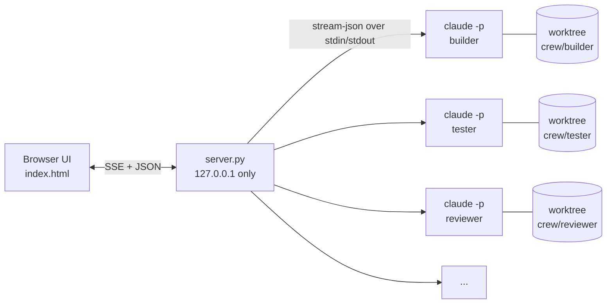

<p align="center">
  
</p>

<p align="center">
  <a href="LICENSE"></a>
  
  
  
  <a href="https://github.com/pranjal-joshi/claude-crew/stargazers"></a>
</p>

<p align="center">
  <b>Run five Claude Code agents at once, like a team.</b><br>
  They pick tasks off a board, work in their own git worktrees, and hand you diffs to approve.<br>
  One Python file, one HTML file, no dependencies.
</p>

<p align="center">
  
</p>

## Try it in 10 seconds

No Claude CLI, no API key, no tokens. Simulated agents play through a real board:

```bash
git clone https://github.com/pranjal-joshi/claude-crew && cd claude-crew
python server.py --demo
```

Open **http://127.0.0.1:8770**.

## Use it on your code

You need [Claude Code](https://docs.claude.com/en/docs/claude-code) installed and signed in (`claude` works in your terminal).

```bash
python server.py --project /path/to/your/repo
```

That's it. Add tasks, and agents whose tags match pick them up.

## Why

Claude Code is great at one task at a time. Real work is a queue: a feature, its tests, a review, some research, the docs.
Running five terminals means five places to watch, five sets of changes tangled in one checkout, and no single place to say yes or no.

Crew gives that queue a home:

- **One board** for every task, with Backlog, In progress, Review and Done columns.
- **Agents that pull their own work.** Each agent has a role and tags; idle agents take matching tasks.
- **No stepping on each other.** Every agent works in its own git worktree on its own `crew/<name>` branch.
- **You stay the reviewer.** Finished work lands in Review with the agent's summary and a real diff. Approve commits it; Send back resumes the same session with your feedback.

## Features

| | |
| --- | --- |
| 🧑‍🤝‍🧑 **A real crew** | Builder, tester, reviewer, researcher and docs by default. Add or remove agents and edit roles from the UI. |
| 🧠 **Model and effort per agent** | Opus for the builder, Haiku for docs, Fable for research: each agent gets its own model and effort level (low to max). |
| 🪢 **Subagents, visible** | When an agent fans out to subagents, you see each one live on the agent card, a count on the task, and a labelled thread in the transcript. |
| 🌳 **Worktree isolation** | One worktree and branch per agent. Merge what you approve with `git merge crew/<name>`. |
| 🔍 **Review gate** | Agent summary and colored diff side by side. Approve and commit, send back, or hand off to another agent. |
| ↪️ **Hand-offs** | Drag any card, in any column, onto another agent. The earlier summary, branch and commit go along as context. |
| 💬 **Talk mid-run** | Message any agent while it works. The message lands in the running session. |
| ☠️ **Kill and respawn** | Kill ends the whole process tree immediately. Respawn resumes the same Claude session or starts fresh. |
| 🔐 **Permission modes** | Accept edits (default), Auto (Claude Code's safety classifier) or Bypass, for all agents from one switch. |
| 🔢 **Tokens and cost** | Live token counts per agent, per task and in total. Hide the dollar amounts with one click. |
| 🧩 **Your skills and MCP servers** | Agents are ordinary Claude Code sessions, so they load your skills, plugins and MCP servers. |
| 📁 **Projects** | Switch repos from the header. Each project keeps its own board, sessions and worktrees. |
| ⌨️ **Keyboard first** | `N` new task, `1`–`9` open an agent, `Ctrl K` command palette, `Esc` close. |

## Screenshots

<table>
  <tr>
    <td width="50%"><br><sub><b>Agent view.</b> Live transcript; subagents get their own labelled thread.</sub></td>
    <td width="50%"><br><sub><b>Review.</b> The agent's summary and its diff. Approve commits to its branch.</sub></td>
  </tr>
  <tr>
    <td width="50%"><br><sub><b>Model and role.</b> Per-agent model, effort, role and tags.</sub></td>
    <td width="50%"><br><sub><b>Board.</b> Agents in flight, subagents counted on each card.</sub></td>
  </tr>
</table>

## How it works



- Each agent is a long-lived `claude -p --input-format stream-json --output-format stream-json` process. Crew writes tasks and your messages to its stdin and reads every event from its stdout.
- A one-second dispatcher gives idle agents work: tasks pinned to them first, then unassigned tasks whose tag matches the agent's tags.
- Subagents are tracked from the stream itself. An `Agent` tool call starts one, events tagged with its `parent_tool_use_id` belong to it, and its tool result ends it.
- State (board, sessions, tokens, transcripts) is saved under `~/.crew/state/`. Worktrees live in `~/.crew/wt/`, which keeps paths short enough for Windows.

## Configuration

`crew.json` is created next to `server.py` on first run and saved whenever you change things in the UI.

```jsonc
{
  "permission_mode": "acceptEdits",          // or "auto", "bypassPermissions"
  "allowed_tools": ["Bash(git status:*)", "Bash(npm test:*)", "Bash(pytest:*)", "WebSearch"],
  "allow_mcp": true,                         // auto-allow MCP servers agents discover (Accept edits mode)
  "agents": [
    {"name": "builder", "role": "Implements features and fixes.", "tags": ["api", "ui", "feature", "bug"],
     "model": "opus", "effort": "high"}
  ]
}
```

| Flag | Default | |
| --- | --- | --- |
| `--project PATH` | a demo repo in `~/.crew` | The repo agents work on. |
| `--port N` | `8770` | |
| `--config PATH` | `./crew.json` | |
| `--demo` | off | Simulated agents and sample tasks. |

`CREW_CLAUDE` overrides the command used to start agents.

### Permissions

Headless agents can't answer permission prompts. In **Accept edits** mode, file edits are allowed and Bash commands outside `allowed_tools` are refused, and the agent is told why. Add the commands your project needs to `allowed_tools`, or switch to **Auto** to let Claude Code's classifier decide. **Bypass** skips all checks and asks you to confirm first.

## Security

- The server binds to `127.0.0.1` only.
- Every write needs a custom request header and a localhost `Host`, so other websites can't drive your agents (CSRF and DNS rebinding).
- Agents are told to stay inside the project folder unless a task names another path.

## FAQ

**Does it cost extra?** No. Agents use your own Claude Code login, so usage counts against your plan or API key like any other Claude Code session. The token counter shows what each agent used.

**Can agents use my skills and MCP servers?** Yes. Each agent loads what `claude` loads in your terminal. Connectors that need sign-in must be signed in once with `claude` → `/mcp`.

**Can an agent spawn its own subagents or background jobs?** Yes, they're full Claude Code sessions. Crew shows subagents live. Kill ends the whole process tree, background jobs included.

**How do I merge an agent's work?** Approve commits to the agent's branch. Then `git merge crew/builder` (or open a PR) like any other branch.

**Which platforms?** Built and tested on Windows 11. macOS and Linux use the same code paths (process groups instead of `taskkill`); reports welcome.

## Roadmap

- [ ] Shared crew memory: a notes file every agent reads at start and adds to at the end
- [ ] Hand-offs that merge the previous agent's branch into the next agent's worktree
- [ ] Background-job and monitor indicators, and holding a task until its jobs finish
- [ ] Task dependencies ("tests after feature")
- [ ] One-click merge of approved branches

Ideas and PRs welcome. Open an issue first for anything big.

## Contributing

The whole app is two files: `server.py` (Python standard library) and `index.html` (vanilla JS). `python server.py --demo` is the fastest loop; `demo/fake_claude.py` speaks the same stream-json protocol as Claude Code.

---

<p align="center">
  If Crew saves you a few terminals, a ⭐ helps others find it.<br>
  <sub>Crew is an independent project and is not affiliated with or endorsed by Anthropic. Claude and Claude Code are trademarks of Anthropic.</sub>
</p>
